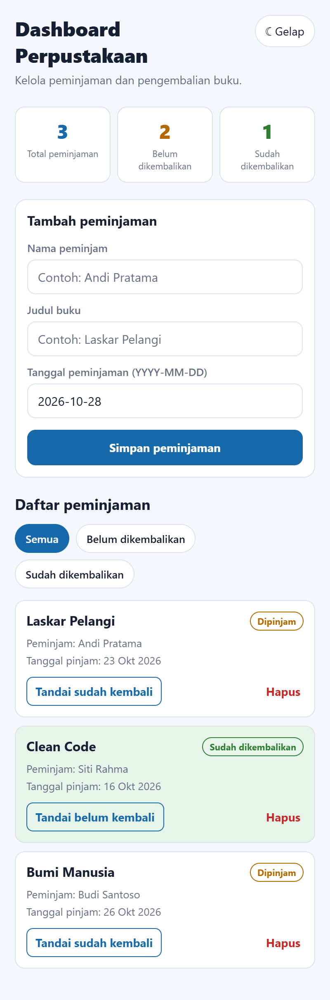
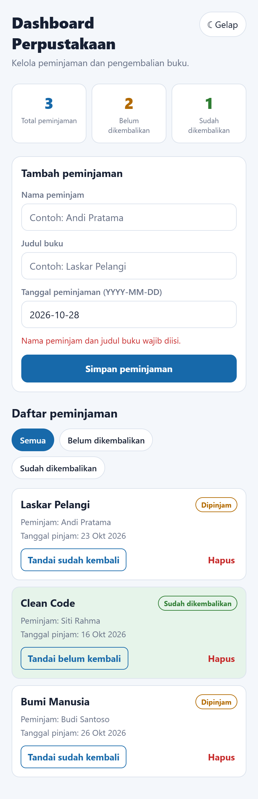
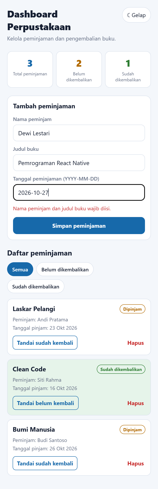
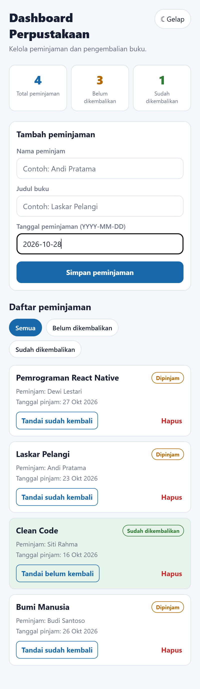
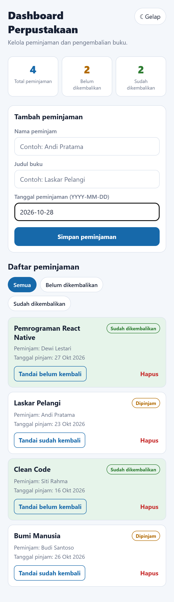
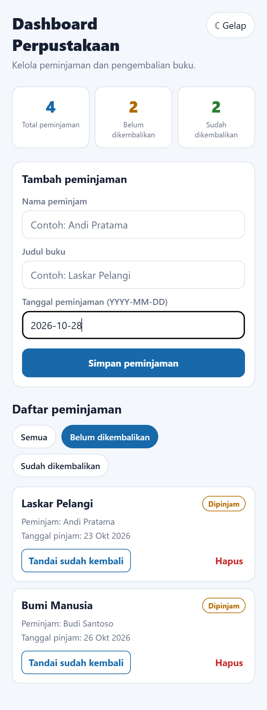
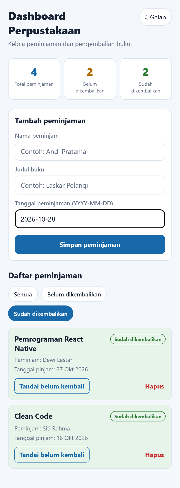
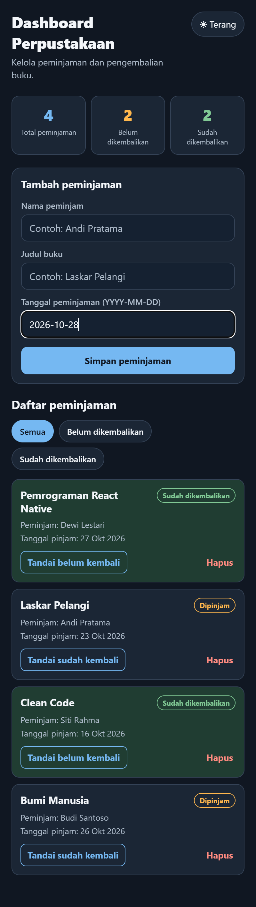
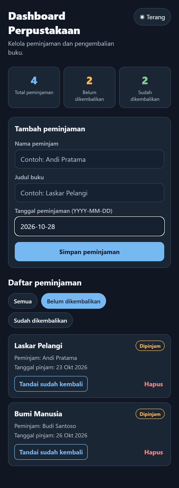

# Dashboard Pengelolaan Peminjaman Buku Perpustakaan

Tugas Praktik Pertemuan 05 Pemrograman Mobile Lanjut (Advanced State Management pada React Native). Aplikasinya dibuat dengan React Native, Expo, dan TypeScript, memakai `useReducer` dan Context API.

Penjelasan penerapan state management, `useReducer`, Context API, dan proses perubahan state ada di **[PENJELASAN.md](PENJELASAN.md)**.

## Menjalankan

```bash
npm install
npx expo start
```

## Screenshot

| Dashboard (terang) | Validasi formulir | Formulir diisi |
|---|---|---|
|  |  |  |

| Setelah tambah | Status diubah | Filter belum dikembalikan |
|---|---|---|
|  |  |  |

| Filter sudah dikembalikan | Tema gelap | Filter (tema gelap) |
|---|---|---|
|  |  |  |
